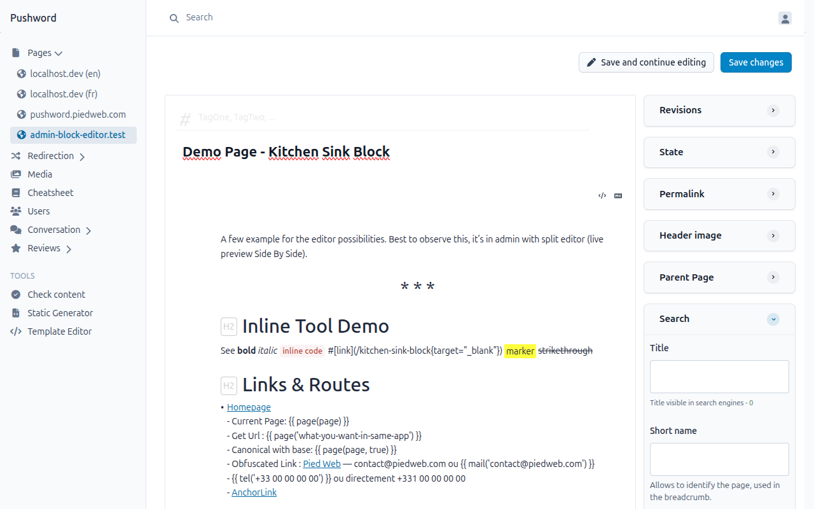

# Pushword

A **Symfony CMS** for Markdown and Twig websites. Manage multiple sites and languages
from one admin. Edit pages in the block editor, work on Markdown in Git,
or update a live site with an AI agent.

[](https://github.com/Pushword/Pushword/tags)
[](LICENSE)
[](https://github.com/Pushword/Pushword/actions)
[](https://github.com/Pushword/Pushword/actions/workflows/run-tests.yml)
[](https://packagist.org/packages/pushword/core)

## Quickstart

You need PHP 8.5 with the [required PHP extensions](https://pushword.piedweb.com/installation#requirements) and Composer.

```shell
composer create-project pushword/new pushword "^1.0"
cd pushword
php -S 127.0.0.1:8004 -t public/
```

The installer sets up SQLite by default and adds demo content. Open the [demo site](http://127.0.0.1:8004/)
and sign in to [the admin](http://127.0.0.1:8004/admin) with the account you create during installation.
For Docker and FrankenPHP setup, see the [installation guide](https://pushword.piedweb.com/installation).



## Why Pushword

- **One admin for multiple sites and languages.** Write in the block editor and manage pages and media across your sites.
- **Content you can review in Git.** Pages use Markdown with YAML front matter, and layouts use Twig. Flat syncs Markdown files with the database, so the same pages stay editable in the admin. [Flat documentation](https://pushword.piedweb.com/extension/flat)
- **AI editing on a live site.** Agents can work on local Markdown or edit through the token-authenticated REST API. Revision checks protect newer page edits from being overwritten. [AI agent guide](https://pushword.piedweb.com/ai-agents)
- **Publish to static hosting.** Export your site for GitHub Pages or serve the files with Apache or FrankenPHP. [Static Generator documentation](https://pushword.piedweb.com/extension/static-generator)
- **Customize it in Symfony.** Use events and entity filters to extend the CMS, and Twig components to build reusable parts of your templates.

## Extensions

The `pushword/new` starter includes the admin and block editor, Flat, the API, static export and page revision history.
Add Search or Newsletter individually with Composer. Install Quiz the same way. [Browse all extensions](https://pushword.piedweb.com/extensions)

To install all maintained bundles together on an existing Pushword site, use the aggregate package.

```shell
composer require "pushword/pushword:^1.0"
```

## Documentation

Visit [pushword.piedweb.com](https://pushword.piedweb.com)

## Contributing

This repository is the monorepo: every bundle lives in `packages/` and is split
read-only to its own repository for distribution. Issues and pull requests belong
**here**.

If you're interested in contributing to Pushword, please read our [contributing docs](https://pushword.piedweb.com/contribute) before submitting a pull request.

If Pushword is useful to you, star the repository so others can find it.
You can also support its maintenance on [Liberapay](https://liberapay.com/RobinPiedWeb).

## Credits

- [PiedWeb](https://piedweb.com)
- [All Contributors](https://github.com/Pushword/Pushword/graphs/contributors)

## License

Pushword is MIT-licensed. See the [License File](https://pushword.piedweb.com/license) for the terms.

<p align="center"><a href="https://dev.piedweb.com">

</a></p>
